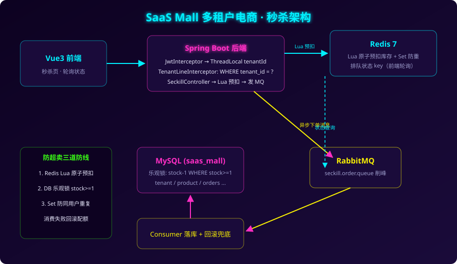

# SaaS Mall — 多租户电商 SaaS 平台

Spring Boot 2.7 + MyBatis-Plus + Redis + RabbitMQ + Vue3 + MySQL。共享库共享表方案，MyBatis-Plus `TenantLineInnerInterceptor` 行级租户隔离，业务代码零侵入；内置高并发秒杀链路（Lua 预扣 + MQ 异步落库 + 乐观锁防超卖）。


## 架构



```
┌──────────────┐   HTTP    ┌───────────────────────────────────────┐
│  Vue3 前端    │ ────────→ │  Spring Boot (8081)                   │
│  (9002)      │           │  JwtInterceptor → ThreadLocal tenantId │
└──────────────┘           │  TenantLineInnerInterceptor            │
       │ 轮询              │  自动拼接 WHERE tenant_id = ?           │
       │                   └───────┬───────────────┬───────────────┘
       │  GET /seckill/{id}/status │               │ MQ 异步下单
       └───────────────────────────┤               ↓
                                   ↓        ┌──────────────┐
                       ┌──────────────┐     │ RabbitMQ      │
                       │ Redis 7      │←───→│ seckill.queue │
                       │ Lua 预扣库存  │     └──────┬───────┘
                       │ 排队状态      │            │ Consumer
                       └──────────────┘            ↓
                                          MySQL (乐观锁扣库存 + 落订单)
```

## 核心亮点

### 1. 行级租户隔离（零侵入）
- 登录 JWT 携带 tenantId → `JwtInterceptor` 写入 ThreadLocal → `TenantLineInnerInterceptor` 给所有 SQL 自动追加 `tenant_id = ?`，查询/更新/删除全覆盖，单条操作（`removeById`）也防越权。
- `TenantContext.clear()` 在 `afterCompletion` 清理，防止线程池复用串租户；MQ 消费线程同样显式 set/clear。
- `tenant` 平台级表在 `SaasTenantLineHandler#ignoreTable` 豁免。

### 2. 秒杀链路（压得住并发）
```
用户点击 → Lua 脚本原子判断[库存>0 且 未重复]并预扣 Redis 配额
        → 发 RabbitMQ 消息，接口立即返回"排队中"（不阻塞）
        → Consumer 落库：UPDATE product SET stock=stock-1 WHERE id=? AND stock>=1 乐观锁
        → 订单状态写 Redis，前端每 1.2s 轮询 → 排队中 → 成功/售罄/失败
        → 消费失败：回滚 Redis 配额 + 移除防重标记，用户可重试
```
三道防线防超卖：Redis Lua 原子预扣 → DB 乐观锁兜底 → Set 防同一用户重复抢。

### 3. 套餐计费（商业化闭环）
- `plan` 表定义套餐能力：月费、商品数上限、秒杀是否开放；`tenant` 表挂 `plan_id` + `expire_time`。
- **配额在写入前校验**：新建商品时 `PlanService#checkProductQuota` 比对当前数量与上限，超限直接拒绝并提示升级。
- **功能按套餐开关**：秒杀是付费能力，免费版调用 `/seckill/list` 返回空、`/buy` 直接拒绝（`seckillEnabled`）。
- **到期控制**：`expire_time` 过期后所有付费能力失效，续费在原有到期日基础上叠加。
- 前端「套餐」页展示配额进度条、到期时间，并支持订阅/续费。

### 4. 审计日志与密码安全
- `AuditAspect` 切所有 Controller，非 GET 请求自动落 `audit_log`（租户、方法、路径、参数、结果），审计失败不影响主流程。
- 密码 BCrypt 存储；兼容存量明文数据——首次登录校验通过后**静默升级**为密文，无需停机迁移。

## 启动

```bash
# 1. 基础设施（MySQL 自动执行 schema.sql，含演示数据）
docker compose up -d

# 2. 后端
cd backend && mvn spring-boot:run    # 8081

# 3. 前端
cd frontend && npm install && npm run dev   # http://localhost:9002
```

## 演示账号

| 租户 | 账号 | 密码 | 套餐 | 秒杀活动 |
|------|------|------|------|----------|
| 店铺A | adminA | 123456 | 专业版（商品50，含秒杀） | 键盘 199 元 限量10 |
| 店铺B | adminB | 123456 | 免费版（商品5，无秒杀） | — |

两个账号登录后商品/订单/秒杀活动完全隔离；B 店可直观看到秒杀被套餐挡住、商品超 5 个被拒。用 JMeter 对 `POST /seckill/{id}/buy` 压测即可验证：只有前 N 个请求成功，其余返回"售罄"，订单数不超配额。

## 设计取舍（面向企业落地）

1. **共享表 vs 独立库**：共享表成本低、运维简单，适合中小租户；大客户可平滑迁独立库——把 Handler 换成数据源路由即可，业务代码不动。
2. **为什么 Lua**：查库存 + 防重 + 扣减三步必须原子，Redis 单线程执行 Lua 天然串行。
3. **为什么 MQ**：把落库从峰值剥离削峰；接口只做准入判定，响应 ms 级。
4. **会不会超卖**：Redis 预扣挡住绝大多数流量，DB 乐观锁兜底极端场景；消费失败回滚 Redis 配额，保证不"吞库存"。
5. **ThreadLocal 坑**：Tomcat 线程池复用，不清会串租户；MQ 消费线程是独立线程，同样要手动 set/clear。
6. **配额为什么在服务层而不是拦截器**：配额规则会随套餐变化（不同套餐不同字段），放服务层便于按业务定制；租户隔离才是基础设施级的，交给拦截器。
7. **套餐到期怎么处理**：只读能力保留（数据不冻结，避免客户投诉），写入与付费功能禁用，引导续费。

## 目录

```
sql/schema.sql            建表 + 演示数据（租户/商品/订单/秒杀/套餐/审计）
docker-compose.yml        mysql + redis + rabbitmq 一键起
docs/                     banner 与架构图
backend/                  Spring Boot（config / seckill / mq / entity / mapper / service / controller）
frontend/                 Vue3 + Vite（赛博朋克 UI：秒杀 / 商品 / 订单 / 套餐）
```
